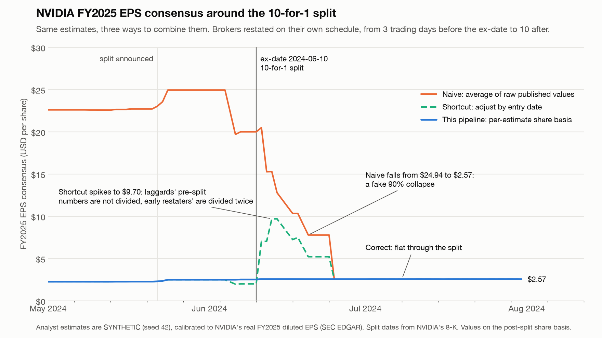
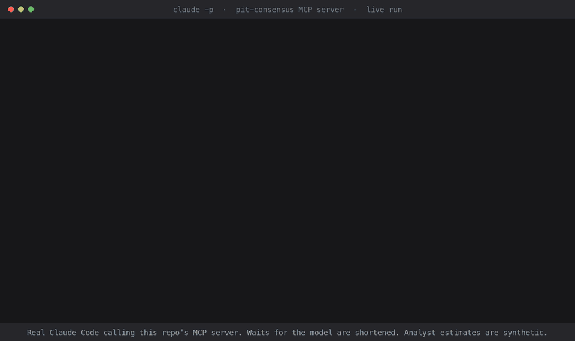

# zacks-pit-demo

**Point-in-time analyst consensus that survives a stock split, with per-estimate share-basis handling, tests pinned to real SEC data, and delivery to people (Python/TS SDKs) and agents (MCP).**



**Claude Code answering over MCP** (live run; [MP4](docs/demo.mp4)):



> **Data note.** Analyst estimates here are **synthetic** (seeded, generated by `src/pitdemo/ingest/synth.py`), because real ones are licensed. EPS actuals (SEC EDGAR), earnings-release times (SEC filing index) and corporate actions (SEC filings, FDIC) are **real**, and every corporate action cites its primary source.

## Quickstart

```bash
uv sync
uv run demo build                     # load DuckDB from the committed data (no network)
uv run demo query NVDA FY2025 2024-05-31
uv run demo serve                     # HTTP API on :8000, docs at /docs
uv run demo mcp                       # MCP over stdio
uv run pytest                         # golden, property, serving and SDK-parity tests
```

Ask Claude, with this repo open in Claude Code (`.mcp.json` registers the server) or with the server added to Claude Desktop:

> What was NVDA's FY2025 EPS consensus on 2024-05-31, split-adjusted?

It calls `get_consensus` and gets **$2.588**: the mean of 8 estimates, as of 2024-05-31 23:59:59 UTC, on the post-split share basis. All of them were published on the pre-split basis (the split was announced 2024-05-22 and took effect 2024-06-10), and each estimate's basis is resolved individually. One more estimate was excluded because it was not re-confirmed after the 2024-05-22 earnings release. On that day's own share basis (`basis="unadjusted"`) the same consensus is $25.88.

<details>
<summary>Claude Desktop config</summary>

```json
{
  "mcpServers": {
    "pit-consensus": {
      "command": "uv",
      "args": ["--directory", "/absolute/path/to/zacks-pit-demo", "run", "demo", "mcp"]
    }
  }
}
```
</details>

## What it shows

| Case | What goes wrong naively | What this does | Test |
|---|---|---|---|
| NVDA 10-for-1 (ex 2024-06-10) | Brokers restate on different days; the raw average falls 90%, and adjusting by entry date swings between $2.02 and $7.15 | Resolves each estimate's share basis (flagged, ratio-inferred, or flagged as a guess) | `test_nvda_mixed_basis.py` |
| Split not yet announced | Applying today's factors to a past query leaks the future | Factors apply only once `known_at ≤ known_as_of` (SEC acceptance time) | `test_split_known_as_of.py` |
| Broker drops coverage | Consensus moves on composition alone | Revision signal compares each broker with itself | `test_broker_drop.py` |
| Stale and un-reconfirmed estimates | Old numbers linger in the average | 120-day staleness and post-earnings re-confirmation, with reasons returned | `test_stale_exclusion.py` |
| EDGAR restatements | Only the latest value is kept | Every filing kept; PIT reads return what was filed by then | `test_restatement.py` |
| SVB failure | Survivorship bias, or history deleted | Leaves the universe at delisting; history stays; tickers are point-in-time (SIVB → SIVBQ) | `test_delisted_sivb.py` |
| FY1 rolls at year end | A relative-label series jumps | Fixed labels stored; FY1/FY2 resolved per query and flagged near a roll | `test_fy_roll.py` |
| GE HealthCare spin-off | Price vendors' 1.281 "split" factor applied to EPS | No EPS factor; pre-spin estimates excluded after the ex-date | `test_spinoff_ge.py` |
| Cache | Stale results after a new split | Content-addressed key over data versions; no invalidation logic | `test_cache.py` |

The corporate-actions table is also checked against the companies' own numbers: for all 12 EDGAR restatement pairs that span a split, the restated EPS equals the original divided by our factor, to the cent.

How consensus is built, how splits and spin-offs are handled, and what is guaranteed point-in-time: **[docs/methodology.md](docs/methodology.md)**.

## Architecture

```
SEC EDGAR (companyfacts, filing index) ─┐
corporate_actions.csv (primary sources) ┼─► Pandera-validated frames ─► DuckDB (append-only, bitemporal)
synthetic estimates (seed 42) ──────────┘                                    │
                                     factors ─► per-estimate basis ─► consensus ─► LRU cache
                                                                                    │
                                              FastAPI ◄── service layer ──► MCP (stdio / streamable HTTP)
                                                 │
                         sdk/schema.json ─► Python SDK (Pydantic) + TypeScript SDK (Zod); CI fails on drift
```

| Concern | Choice |
|---|---|
| Frames / store | Polars, DuckDB, Parquet |
| Validation | Pandera (frames entering the store), Pydantic v2 (everything at the boundary) |
| Serving | FastAPI; official MCP Python SDK (`MCPServer`, v2) |
| SDKs | `sdk/python` (httpx + generated Pydantic models), `sdk/ts` (fetch + generated Zod schemas) |
| Quality | pytest, Hypothesis, ruff, mypy `--strict`; GitHub Actions on Python 3.12 and 3.15, plus an end-to-end smoke job (HTTP server, both SDKs, MCP over stdio) |

## Commands

```bash
uv run demo ingest     # re-fetch EDGAR + prices, cross-check splits (network; set SEC_USER_AGENT="Name email")
uv run demo synth      # regenerate synthetic estimates (seed 42)
uv run demo build      # load DuckDB
uv run demo chart      # docs/nvda_consensus.png
uv run demo sdk        # regenerate sdk/schema.json, Python models, Zod schemas
uv run demo serve      # FastAPI on :8000
uv run demo mcp        # MCP over stdio (--transport streamable-http for HTTP on :8001)
uv run python scripts/ci/smoke.py   # end-to-end: server + Python/TS SDKs + MCP stdio

# Re-record docs/demo.gif + docs/demo.mp4 (runs real Claude Code headless against the MCP server)
uv run python scripts/record/capture.py docs/demo.cast
uv run python scripts/record/render.py docs/demo.cast docs/demo.mp4 docs/demo.gif
```

The committed `data/raw/` holds slimmed EDGAR JSON and the corporate-actions CSV, so everything except `ingest` runs offline. Price data is fetched only to cross-check split dates and is not committed.

## Layout

```
src/pitdemo/
  ids.py              permanent IDs, point-in-time ticker mapping, universe
  periods.py          fiscal calendars, FY1/FY2 resolution
  schemas.py          Pandera frame schemas + Pydantic boundary models
  store.py            DuckDB, append-only; superseded_at derived in a view
  ingest/             edgar.py, prices.py, actions.py, synth.py
  transforms/         factors.py, basis.py, consensus.py, cache.py
  service.py          shared by HTTP and MCP
  api/                http.py, mcp_server.py
tests/golden/         one file per edge case, exact expected values
tests/property/       Hypothesis: adjustment algebra, consensus invariants
docs/                 methodology.md, llms.txt, nvda_consensus.png
.claude/skills/       query-pit-consensus: how an agent should query
```
